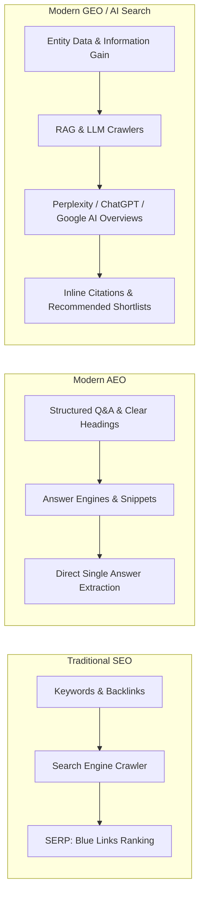
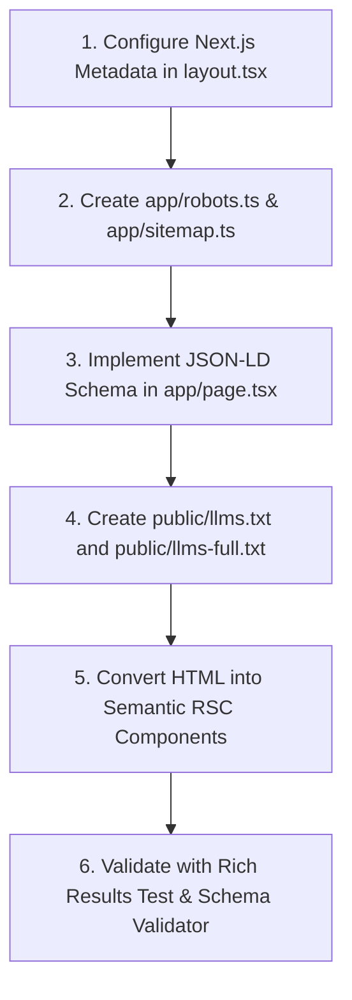

# Step 1 Advisors — Master SEO, AEO & GEO Architectural Blueprint

> **Target Site**: Step 1 Advisors (`step1advisors.com`)  
> **Framework**: Next.js App Router (React Server Components)  
> **Disciplines Covered**:
> 1. **Traditional SEO**: Google / Bing technical crawlability, Core Web Vitals, indexation, semantic HTML, metadata, and canonicalization.
> 2. **AEO (Answer Engine Optimization)**: Direct answer extraction for Google Featured Snippets, voice assistants, and immediate answers.
> 3. **GEO (Generative Engine Optimization)**: AI search visibility, citation engineering, and knowledge retrieval across **Perplexity AI, ChatGPT Search, Google AI Overviews (SGE), Claude, and Microsoft Copilot**.

---

## 1. Executive Summary: The SEO → AEO → GEO Shift

The search landscape has shifted from **ranking 10 blue links** to **being cited as the authoritative source** in synthesized AI responses:



### The Three Pillars of Modern Visibility for Step 1 Advisors
1. **Machine-Readable Structure (RSC + JSON-LD)**: 100% server-rendered static HTML with rich nested schema (`AccountingService`, `Person`, `FAQPage`, `OfferCatalog`) so crawlers and scrapers parse the site without executing heavy client-side JavaScript.
2. **AI-Optimized Knowledge Ingestion (`llms.txt` + `llms-full.txt`)**: Adopting the Jeremy Howard open standard to deliver a lightweight, high-signal markdown index and a single-file knowledge summary directly at `/llms.txt` and `/llms-full.txt`.
3. **High Information Gain & E-E-A-T Content Engineering**: Financial services fall under Google's strict **YMYL (Your Money or Your Life)** umbrella. Content must feature verifiable accounting standards (ASC 606, IFRS 15, ASC 842, Ind AS 116), named credentials (ICAI, CPA, PCAOB, Xero), and direct, inverted-pyramid answers.

---

## 2. Next.js App Router Technical SEO Architecture

Next.js App Router with React Server Components (RSC) provides the optimal foundation for SEO because all HTML, metadata, and structured data are generated server-side on the initial HTTP response.

```
app/
├── layout.tsx             # Root layout: metadataBase, global metadata, fonts, viewport
├── page.tsx               # Server Component: Semantic HTML5, structured JSON-LD script
├── sitemap.ts             # Dynamic XML Sitemap generator
├── robots.ts              # Crawler permission matrix (welcoming AI bots)
├── manifest.ts            # Web App Manifest for mobile SERP rich indexing
public/
├── llms.txt               # Curated AI knowledge index (standard specification)
├── llms-full.txt          # Full consolidated markdown knowledge base for LLMs
└── favicon.ico            # Brand favicon & touch icons
```

---

### 2.1 Complete Root Metadata Configuration (`app/layout.tsx`)

Next.js replaces legacy `<head>` tags with the typed `Metadata` API. It must include explicit canonicalization, OpenGraph, Twitter Cards, robots directives, and search engine verification tokens.

```tsx
import type { Metadata, Viewport } from "next";

export const viewport: Viewport = {
  themeColor: "#17140f",
  width: "device-width",
  initialScale: 1,
  maximumScale: 5,
};

export const metadata: Metadata = {
  metadataBase: new URL("https://step1advisors.com"),
  title: {
    default: "Step 1 Advisors — Fractional CFO, GAAP Advisory, Accounting & Audit",
    template: "%s | Step 1 Advisors",
  },
  description:
    "Step 1 Advisors runs the fractional CFO, technical GAAP advisory, accounting, tax, and audit-readiness work of a full finance department under US GAAP, IFRS, UK GAAP, or Ind AS.",
  applicationName: "Step 1 Advisors",
  authors: [
    { name: "CA Kshitij", url: "https://step1advisors.com#leadership" },
    { name: "CA Mayank A", url: "https://step1advisors.com#leadership" },
  ],
  generator: "Next.js",
  keywords: [
    "Fractional CFO",
    "US GAAP Advisory",
    "Technical Accounting Memos",
    "ASC 606 Revenue Recognition",
    "ASC 842 Lease Accounting",
    "Ind AS Accounting",
    "IFRS Advisory",
    "Outsourced Controller",
    "Monthly Close Bookkeeping",
    "Audit Readiness",
    "Cross-border India US UK accounting",
    "SOC Readiness",
  ],
  referrer: "origin-when-cross-origin",
  creator: "Step 1 Advisors",
  publisher: "Step 1 Advisors",
  formatDetection: {
    email: true,
    address: true,
    telephone: true,
  },
  alternates: {
    canonical: "https://step1advisors.com",
    languages: {
      "en-US": "https://step1advisors.com",
      "en-GB": "https://step1advisors.com",
      "en-IN": "https://step1advisors.com",
    },
  },
  openGraph: {
    title: "Step 1 Advisors — Outsourced Finance, GAAP, Tax & Audit",
    description:
      "The finance team you'd otherwise assemble one hire at a time. Fractional CFO, GAAP advisory, controller, and audit assurance under US GAAP, IFRS, and Ind AS.",
    url: "https://step1advisors.com",
    siteName: "Step 1 Advisors",
    images: [
      {
        url: "/og-image.png", // Recommended size: 1200x630px
        width: 1200,
        height: 630,
        alt: "Step 1 Advisors — Outsourced Finance Function",
      },
    ],
    locale: "en_US",
    type: "website",
  },
  twitter: {
    card: "summary_large_image",
    title: "Step 1 Advisors — Fractional CFO, GAAP Advisory & Audit",
    description:
      "Fractional CFO, technical GAAP accounting, and audit readiness for founder-led and PE-backed cross-border companies.",
    images: ["/og-image.png"],
    creator: "@step1advisors",
  },
  robots: {
    index: true,
    follow: true,
    nocache: false,
    googleBot: {
      index: true,
      follow: true,
      "max-video-preview": -1,
      "max-image-preview": "large",
      "max-snippet": -1,
    },
  },
};
```

---

### 2.2 Dynamic Crawler Permissions Matrix (`app/robots.ts`)

To maximize visibility across modern AI search engines, **AI user-agents must be explicitly permitted** rather than lumped under generic blocks.

```ts
import type { MetadataRoute } from "next";

export default function robots(): MetadataRoute.Robots {
  const baseUrl = "https://step1advisors.com";

  return {
    rules: [
      {
        userAgent: "*",
        allow: "/",
        disallow: ["/api/", "/admin/", "/temp/"],
      },
      // Explicitly welcome major LLM search crawlers
      {
        userAgent: [
          "GPTBot",             // OpenAI ChatGPT training crawler
          "OAI-SearchBot",      // OpenAI live ChatGPT Search agent
          "PerplexityBot",      // Perplexity AI live search engine
          "ClaudeBot",          // Anthropic Claude search crawler
          "Google-Extended",    // Google Gemini / Vertex grounding
          "Applebot-Extended",  // Apple Intelligence search engine
          "Bingbot",            // Microsoft Copilot & Bing search
        ],
        allow: "/",
      },
    ],
    sitemap: `${baseUrl}/sitemap.xml`,
    host: baseUrl,
  };
}
```

---

### 2.3 Dynamic XML Sitemap (`app/sitemap.ts`)

```ts
import type { MetadataRoute } from "next";

export default function sitemap(): MetadataRoute.Sitemap {
  const baseUrl = "https://step1advisors.com";
  const lastModified = new Date();

  return [
    {
      url: baseUrl,
      lastModified,
      changeFrequency: "weekly",
      priority: 1.0,
    },
    {
      url: `${baseUrl}/#services`,
      lastModified,
      changeFrequency: "monthly",
      priority: 0.9,
    },
    {
      url: `${baseUrl}/#how-we-work`,
      lastModified,
      changeFrequency: "monthly",
      priority: 0.8,
    },
    {
      url: `${baseUrl}/#industries`,
      lastModified,
      changeFrequency: "monthly",
      priority: 0.8,
    },
    {
      url: `${baseUrl}/#leadership`,
      lastModified,
      changeFrequency: "monthly",
      priority: 0.8,
    },
    {
      url: `${baseUrl}/#faq`,
      lastModified,
      changeFrequency: "weekly",
      priority: 0.8,
    },
    {
      url: `${baseUrl}/#contact`,
      lastModified,
      changeFrequency: "yearly",
      priority: 0.7,
    },
  ];
}
```

---

## 3. Advanced Schema.org Structured Data (JSON-LD)

Generative AI models and traditional search engines build their Knowledge Graph from structured data. For Step 1 Advisors, we inject a multi-entity schema graph containing:

1. **`AccountingService` / `FinancialService`**: The core organization entity with headquarters, cross-border jurisdiction, contact details, and price model.
2. **`OfferCatalog`**: Explicit list of the 4 practice offerings.
3. **`Person` (Founders & Managing Partners)**: CA Kshitij and CA Mayank A with their qualifications (`ICAI`, `Big 4`, `UK mainland audit`), establishing direct **E-E-A-T**.
4. **`FAQPage`**: All 6 diagnostic pre-call questions and comprehensive answers for Google Rich Snippets and Perplexity direct extraction.

### Implementation: Safe JSON-LD Injection (`app/page.tsx`)

```tsx
export default function Page() {
  const jsonLd = {
    "@context": "https://schema.org",
    "@graph": [
      {
        "@type": ["AccountingService", "ProfessionalService", "FinancialService"],
        "@id": "https://step1advisors.com/#organization",
        name: "Step 1 Advisors",
        legalName: "Step 1 Advisors",
        url: "https://step1advisors.com",
        logo: "https://step1advisors.com/logo.png",
        image: "https://step1advisors.com/og-image.png",
        description:
          "Step 1 Advisors runs the fractional CFO, technical GAAP advisory, monthly accounting, and audit-readiness work of a full finance department under US GAAP, IFRS, UK GAAP, or Ind AS.",
        telephone: "+44-7405-499-593",
        email: "welcome@step1advisors.com",
        priceRange: "$$$$",
        currenciesAccepted: "USD, GBP, INR, EUR",
        paymentAccepted: "Wire Transfer, ACH, Credit Card",
        address: {
          "@type": "PostalAddress",
          addressLocality: "Gurugram",
          addressRegion: "Delhi NCR",
          addressCountry: "IN",
          description: "Global delivery headquarters with remote engagements worldwide",
        },
        areaServed: [
          { "@type": "Country", name: "United States" },
          { "@type": "Country", name: "United Kingdom" },
          { "@type": "Country", name: "India" },
          { "@type": "Country", name: "Singapore" },
        ],
        founder: [
          {
            "@type": "Person",
            name: "CA Kshitij",
            jobTitle: "Managing Partner, GAAP Advisory",
            honorificPrefix: "CA",
            alumniOf: "The Institute of Chartered Accountants of India (ICAI)",
            knowsAbout: [
              "US GAAP (ASC 606, ASC 842, ASC 718)",
              "IFRS",
              "Ind AS",
              "Cross-border UK-India entity structures",
              "Technical Accounting Memos",
            ],
            description:
              "Ten years split between Big Four and Big Six audit firms FP&A, including 5 years UK mainland audit experience.",
          },
          {
            "@type": "Person",
            name: "CA Mayank A",
            jobTitle: "Partner, Audit & Assurance",
            honorificPrefix: "CA",
            alumniOf: "The Institute of Chartered Accountants of India (ICAI)",
            knowsAbout: [
              "Financial Statement Audits under GAAS",
              "PCAOB Standards",
              "SOC Readiness",
              "Independence Frameworks",
              "Agreed-Upon Procedures",
            ],
            description:
              "Former audit manager at a Big 4 assurance practice. Runs the firm's independence framework and leads non-financial statement audits and SOC readiness.",
          },
        ],
        hasOfferCatalog: {
          "@type": "OfferCatalog",
          name: "Financial Advisory Services",
          itemListElement: [
            {
              "@type": "Offer",
              itemOffered: {
                "@type": "Service",
                name: "Fractional CFO",
                description:
                  "Monthly board reporting packages, 13-week cash flow modeling, variance reviews, and fundraise support for companies scaling past $1.5M ARR.",
              },
            },
            {
              "@type": "Offer",
              itemOffered: {
                "@type": "Service",
                name: "Technical GAAP Advisory",
                description:
                  "Revenue recognition memos (ASC 606 / IFRS 15), lease accounting (ASC 842 / IFRS 16), and stock compensation (ASC 718 / IFRS 2).",
              },
            },
            {
              "@type": "Offer",
              itemOffered: {
                "@type": "Service",
                name: "Strategic Remote Accounting & Advisory",
                description:
                  "Full-cycle bookkeeping, AP/AR coordination, KPI dashboards, and monthly close delivered by the 10th business day inside existing software stacks.",
              },
            },
            {
              "@type": "Offer",
              itemOffered: {
                "@type": "Service",
                name: "Audit & Assurance",
                description:
                  "Independent financial statement audits under GAAS, SOC readiness assessments, and agreed-upon procedures adhering to AICPA and ICAI independence standards.",
              },
            },
          ],
        },
      },
      {
        "@type": "FAQPage",
        "@id": "https://step1advisors.com/#faq",
        mainEntity: [
          {
            "@type": "Question",
            name: "Which jurisdictions does Step 1 Advisors work in?",
            acceptedAnswer: {
              "@type": "Answer",
              text: "We serve clients incorporated in the US, and companies with a US entity paired with an Indian, UK, or Singapore subsidiary. Our technical accounting covers US GAAP, IFRS, and Ind AS.",
            },
          },
          {
            "@type": "Question",
            name: "Can Step 1 Advisors handle both our audit and our monthly accounting?",
            acceptedAnswer: {
              "@type": "Answer",
              text: "Not at the same time, and not for the same fiscal year. Independence standards require that we not audit books we also maintain. Most clients pick one or the other with us; some rotate audit providers so we can run their advisory work continuously.",
            },
          },
          {
            "@type": "Question",
            name: "How is pricing structured at Step 1 Advisors?",
            acceptedAnswer: {
              "@type": "Answer",
              text: "A fixed monthly retainer, scoped to your entity count, transaction volume, and reporting cadence in the engagement letter. Audit and one-off projects — like a PPA or an R&D credit study — are quoted separately and fixed before work starts.",
            },
          },
          {
            "@type": "Question",
            name: "What accounting systems do you work inside?",
            acceptedAnswer: {
              "@type": "Answer",
              text: "QuickBooks Online, NetSuite, and Xero most often, along with Bill.com, Ramp, Ramp Payroll, Gusto, and Ind AS-compliant systems like Tally and Zoho Books for Indian subsidiaries. We work inside your existing stack rather than migrating you to ours.",
            },
          },
          {
            "@type": "Question",
            name: "How quickly can an engagement start with Step 1 Advisors?",
            acceptedAnswer: {
              "@type": "Answer",
              text: "Most clients move from diagnostic call to signed scope within two weeks, and see their first monthly close delivered on our calendar within 30–45 days — sooner if books are already current.",
            },
          },
          {
            "@type": "Question",
            name: "Do you work with companies that don't have a controller yet?",
            acceptedAnswer: {
              "@type": "Answer",
              text: "That's most of our client base. We typically step in as the first dedicated finance function a company has had, and either hand off to an internal hire later or stay embedded indefinitely — whichever the business needs.",
            },
          },
        ],
      },
    ],
  };

  return (
    <>
      <script
        type="application/ld+json"
        dangerouslySetInnerHTML={{
          __html: JSON.stringify(jsonLd).replace(/</g, "\\u003c"),
        }}
      />
      {/* Page Content */}
    </>
  );
}
```

---

## 4. The `llms.txt` and `llms-full.txt` Standard for AI Search

To capture high **Share of Model (SoM)** across AI search engines (such as Perplexity, ChatGPT, Claude, and developer agents), we implement the Jeremy Howard `llms.txt` standard in `/public/llms.txt` and `/public/llms-full.txt`.

### 4.1 `/public/llms.txt` (Curated AI Index)

```markdown
# Step 1 Advisors
> The outsourced finance function for founder-led and PE-backed cross-border companies under US GAAP, IFRS, UK GAAP, and Ind AS.

Step 1 Advisors operates fractional CFO, technical accounting advisory, controller services, and independent audit assurance across cross-border entity structures (US, UK, India, Singapore).

## Core Practices & Services
- [Fractional CFO Services](https://step1advisors.com#fractional-cfo): Board reporting, 13-week cash runway modeling, budgeting, variance reviews, and fundraising diligence for companies scaling past $1.5M ARR.
- [Technical GAAP Advisory](https://step1advisors.com#gaap-advisory): Revenue recognition memos (ASC 606 / IFRS 15), lease accounting (ASC 842 / IFRS 16), and stock-based compensation (ASC 718 / IFRS 2).
- [Strategic Remote Accounting & Advisory](https://step1advisors.com#accounting-advisory): Full-cycle bookkeeping, AP/AR, multi-currency consolidation, and monthly close delivered by the 10th business day.
- [Audit & Assurance Practice](https://step1advisors.com#audit-assurance): Independent GAAS financial statement audits, SOC readiness assessments, and agreed-upon procedures adhering to AICPA and ICAI independence rules.

## Operating Principles & FAQs
- [Engagement Model & Process](https://step1advisors.com#how-we-work): 45-minute diagnostic call, fixed-fee scoped engagement design, and embedded Slack/calendar delivery.
- [Auditor Independence Statement](https://step1advisors.com#audit-assurance): Strict separation preventing simultaneous audit and monthly accounting for the same fiscal year.
- [Frequently Asked Questions](https://step1advisors.com#faq): Jurisdictions, pricing models, accounting stacks (NetSuite, QuickBooks, Xero, Zoho, Tally), and onboarding timelines.

## Leadership & Credentials
- [CA Kshitij - Managing Partner, GAAP Advisory](https://step1advisors.com#leadership): CA (ICAI), 10 years Big Four & Big Six FP&A, 5 years UK mainland audit experience.
- [CA Mayank A - Partner, Audit & Assurance](https://step1advisors.com#leadership): CA (ICAI), former Big 4 assurance audit manager, lead of firm independence framework.

## Contact
- [Discovery Call Booking](https://step1advisors.com#contact): Email welcome@step1advisors.com, Phone +44 (0) 7405-499-593. Headquarters: Gurugram, Delhi NCR, India (engagements delivered remotely).
```

### 4.2 `/public/llms-full.txt` (Consolidated Knowledge Base)
A single document providing the full textual breakdown of the entire firm in raw markdown format, allowing an AI model to ingest all facts in a single token-efficient HTTP request.

---

## 5. AEO & GEO Optimization Strategies

| AI Search Engine | Retrieval Mechanism | What it Values Most | Step 1 Advisors Architectural Implementation |
| :--- | :--- | :--- | :--- |
| **Perplexity AI** | Live RAG web crawl for each query | Fresh citations, statistical specifics, named authors, bullet points | Clear author bios with verifiable credentials (ICAI, Big 4, UK audit), explicit numbers ("close by 10th business day", "savings up to 60%", "$1.5M ARR threshold"). |
| **ChatGPT Search** | Live web browsing + foundational model memory | Brand co-occurrence, clean markdown hierarchy, direct entity definitions | Question-led H2/H3 headings, clear definitions within the first 50 words, unencumbered server-rendered text. |
| **Google AI Overviews (SGE)** | Query Fan-Out (breaks 1 query into 3–5 subqueries) | Information Gain, semantic depth, schema validation | Comprehensive coverage of related topics (e.g. standard conversions, SOC readiness, independence rules, entity consolidation) in a single page. |
| **Claude / Anthropic** | High-context document ingestion | Logically sound arguments, absence of marketing fluff, structural rigor | High-density accounting prose, precise standard citations (ASC 606, IFRS 15, ASC 842, Ind AS 116). |

### 5.1 The Inverted Pyramid Writing Formula for Answer Engines
For every service and FAQ item, the text must follow this exact 3-step sequence:
1. **Direct Answer (Sentence 1–2, 35–50 words)**: Definitive factual answer stating who, what, and the threshold.
2. **Context & Scope (Sentence 3–5)**: Explaining the mechanism (e.g. ASC 606 revenue recognition, NetSuite stack, 10th business day close).
3. **Outcome / Boundary Statement**: Clearly noting exclusions (e.g. auditor independence rules, $1.5M ARR fit).

---

## 6. Semantic HTML5 & On-Page Checklist

To ensure search bots parse content effortlessly:

- [x] **Single `<h1>`**: Only one per page, describing the core value proposition.
- [x] **Strict Heading Hierarchy**: `H1` (Hero) → `H2` (Section Titles) → `H3` (Sub-practices, steps, leadership). No skipped levels (`H1` to `H4`).
- [x] **Semantic Landmarks**:
  - `<header>` for navigation and logo
  - `<main>` enclosing core page content
  - `<section id="...">` for each major thematic block with unique IDs for anchor jumps
  - `<article id="...">` for each self-contained service practice
  - `<details>` and `<summary>` for FAQs (native collapsible HTML parsed by search engines)
  - `<footer>` for colophon, copyright, and physical location
- [x] **Unique Interactive Element IDs**: All form inputs, labels, and buttons must have explicit `id`, `name`, `htmlFor`, and `aria-label` attributes.
- [x] **Zero Cumulative Layout Shift (CLS)**: Fonts (`Newsreader` and `Work Sans`) preloaded via Next.js `next/font/google`, reserving layout boxes to eliminate font-swap shifts.
- [x] **Image / SVG Accessibility**: All SVGs role-marked (`role="img"`) with descriptive `aria-label` attributes.

---

## 7. Action Plan for Implementation


